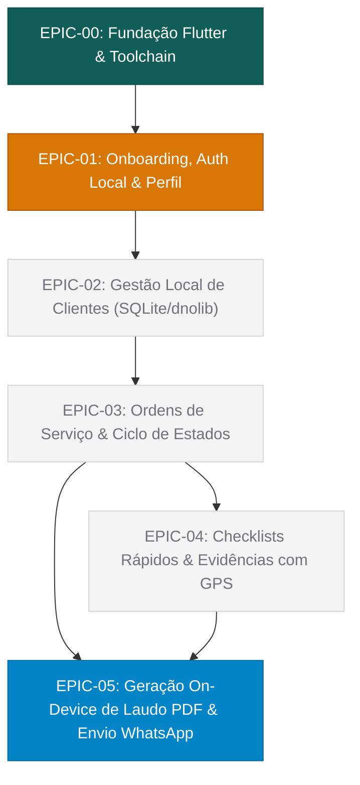

# Plano Mestre de Implementação — ServiceTrack (Mobile Standalone)

> **Responsável do Plano (DevOps / Arch)**: Denerson Nobre  
> **Status Geral**: `Fase de Fundação (Greenfield Lock)`  
> **Arquitetura**: Flutter 100% Autocontido (Zero Backend / Zero Infraestrutura de Nuvem)  
> **Referências**: [PRD](../product/PRD.md) \| [SPEC](../architecture/SPEC.md) \| [DESIGN](../architecture/DESIGN.md)

---

## 1. Relação de Épicos Fatiados & Matriz de Status

| Épico | Arquivo | Dependências | Prioridade | Status |
| :--- | :--- | :--- | :---: | :---: |
| **00 — Fundação Flutter** | [epic-00-fundacao.md](epics/epic-00-fundacao.md) | Nenhuma (Alicerce Técnico) | Crítica | `Concluído` |
| **01 — Onboarding, Auth Local & Perfil** | [epic-01-auth-perfil.md](epics/epic-01-auth-perfil.md) | EPIC00 | Alta | `Pronto para Iniciar` |
| **02 — Gestão Local de Clientes** | [epic-02-clientes.md](epics/epic-02-clientes.md) | EPIC00, EPIC01 | Alta | `Bloqueado` |
| **03 — Ordens de Serviço & Ciclo de Vida** | [epic-03-ordens-servico.md](epics/epic-03-ordens-servico.md) | EPIC00, EPIC02 | Alta | `Bloqueado` |
| **04 — Checklists, Câmera & Evidências GPS** | [epic-04-checklists-evidencias.md](epics/epic-04-checklists-evidencias.md) | EPIC00, EPIC03 | Alta | `Bloqueado` |
| **05 — Motor de Laudo PDF & Compartilhamento** | [epic-05-laudo-pdf-share.md](epics/epic-05-laudo-pdf-share.md) | EPIC00, EPIC03, EPIC04 | Crítica (Core) | `Bloqueado` |

---

## 2. DAG de Precedência (Mermaid)

---

## 3. Ordem Canônica de Execução (Core-First & Risk-First)

1. **EPIC00 (Fundação Flutter)**: Configurar projeto Flutter, design tokens do Styleguide v2.1, scripts de teste headless e shims de claim.
2. **EPIC01 (Onboarding & Auth Local)**: Primeiro acesso do técnico, cadastro de perfil e cofre seguro de Biometria/PIN.
3. **EPIC02 (Clientes)**: Estrutura cadastral local com SQLite via `dnolib/sqlite` e validações `brlib`.
4. **EPIC03 (Ordens de Serviço)**: Motor da máquina de estados (`SCHEDULED` -> `IN_PROGRESS` -> `COMPLETED`).
5. **EPIC04 (Checklists & Fotos)**: Captura de evidências com compressão e coordenadas do GPS.
6. **EPIC05 (Laudo PDF & WhatsApp)**: O núcleo de maior valor perceptível para o técnico autônomo (gerar laudo executivo e disparar pelo WhatsApp com 1 toque).
